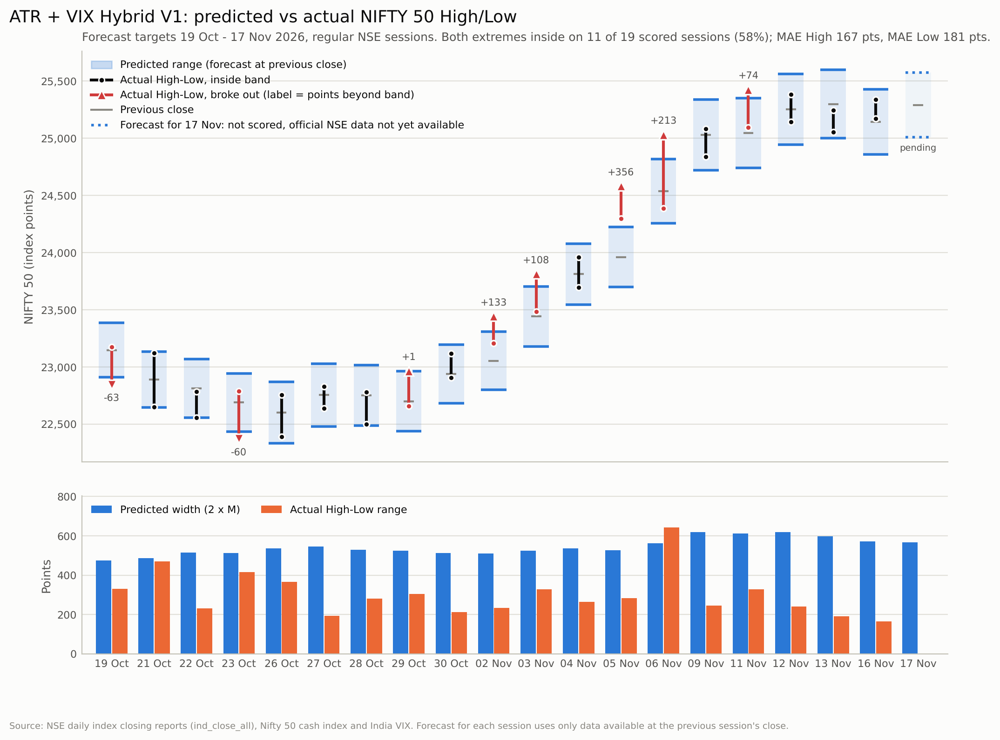

# NIFTY 50 next-day High/Low forecast: "ATR + VIX Hybrid V1" backtest

**Verdict: NOT PROMISING** as a reliable next-session range predictor in its current form (details in §5).
**The code was executed:** every number, table and chart below was produced by the Python code in this folder
(last run 2026-11-17 21:03 UTC); nothing was estimated by hand.

| | |
|---|---|
| Test window | Forecast targets 18 Oct to 17 Nov 2026: **20 regular NSE sessions** (19 Oct to 17 Nov) plus the 8 Nov Muhurat special session |
| Scored | **19 regular sessions** (19 Oct to 16 Nov). **17 Nov is not scored**: NSE's official 17 Nov file was not yet available when the backtest ran (§1.4) |
| Indicator history | 1 Jun 2026 to 16 Nov 2026 (116 regular sessions + Muhurat) |
| Data | NSE's official daily index closing reports (`ind_close_all_DDMMYYYY.csv`): **Nifty 50 cash index** OHLC and **India VIX** |
| Parameters | Exactly as specified: ATR 14 (Wilder), weights 0.50 / 0.50, sqrt(252). Nothing was tuned |

---

## Executive summary (plain English)

* **What was tested.** Every evening, the strategy takes the day's NIFTY close and draws a band around it:
  close ± M, where M is half the 14-day ATR plus half the one-day move implied by India VIX. The band is meant to
  contain the next day's High and Low.
* **How often did it work?** On **11 of the 19** sessions that could be scored (**58%**), the whole next-day
  range stayed inside the band. On the other **8 days** the market broke out of it: 6 times on the upside, during
  a sharp rally in which NIFTY rose **11.5% in 10 sessions** (28 Oct to 12 Nov).
* **The band was wide and still missed.** The band averaged **543 points**, while NIFTY's actual daily range
  averaged **302 points** (1.8 times larger). Even so, it missed 8 of 19 days.
* **How close were the predicted High and Low?** Not close. The predicted High was on average **167 points**
  from the actual High, and the predicted Low **181 points** from the actual Low. Only **26%** of predicted Highs
  and **37%** of predicted Lows landed within 100 points of the actual values.
* **Against the alternatives.** Under the ranking rule fixed before the results were seen, Hybrid V1 came
  **first of five**, but only on a tie-break. ATR-only contained more days (63%) with a wider band. VIX-only and
  Camarilla were narrower and placed their boundaries closer to the actual extremes, but contained far fewer days
  (42% and 32%). Using the previous day's High/Low was clearly worst (11%). On the 2½ months before the test,
  the same rule ranked Hybrid **third**, so the ranking is not stable.
* **Did India VIX help?** Not in any useful way. In this period the VIX-implied move was smaller than ATR, so
  adding VIX simply made the band about **65 points narrower**. VIX gave no early warning of the bad days: it
  averaged 15.6 the evening before the 8 failures and 16.3 before the 11 successes. It also did not widen the
  band on the right days (§3.5).
* **Why it failed.** Most misses were not unusually volatile days. The market **opened far away** from the
  previous close (a gap) and kept trending. A band centred on yesterday's close cannot handle that. The worst day,
  5 Nov, opened 417 points higher after the US mid-term election result, so the whole session traded above the
  band (miss: 356 points).
* **Bottom line.** In this month the strategy was **neither reliable (58% containment, 95% confidence interval
  36–77%) nor precise (errors around 170 points)**. The same fixed formula on the preceding 2½ months reached only
  64% containment with a band twice the actual range. One month cannot prove anything long-term (§4, Q7), but
  nothing measured here supports using it for live trading. Prediction accuracy also says nothing about trading
  profit, which was not tested.

---

## 1. Data

### 1.1 What was used
For every NSE session, NSE publishes one official file,
`https://nsearchives.nseindia.com/content/indices/ind_close_all_DDMMYYYY.csv`, with Open/High/Low/Close for
every index. From each file the backtest uses only two rows:

* **`Nifty 50`**: the cash index, not futures (`Nifty 50 Futures Index` is a separate row and is not used);
* **`India VIX`**: its daily close feeds VIX_Move.

Taking both series from the same official file guarantees that NIFTY and VIX refer to exactly the same session.
The documented input file is [`data/nifty50_india_vix_daily.csv`](data/nifty50_india_vix_daily.csv): 117 rows,
1 Jun to 16 Nov 2026. Each row carries its official NSE URL, the archives holding it and its file hash.

### 1.2 How it was obtained, and why not directly from NSE
The network policy of the cloud environment where this backtest ran **blocked** `niftyindices.com`, `nseindia.com`,
`nsearchives.nseindia.com` (and Yahoo, Stooq, Investing.com, Google Finance and BSE). Opening them up required an
environment change, which was declined. The same official NSE files were therefore read from **five independent
public GitHub archives**. Each runs its own scheduled job that downloads `ind_close_all` from NSE and stores it
unmodified:

| Archive (pinned snapshot) | Files used | Coverage in range |
|---|---|---|
| [Chaudharyrohit2506/bhavcopy @ d321094](https://github.com/Chaudharyrohit2506/bhavcopy/tree/d321094580e9e4cc1ecdd831e3b2590b801dbf71/data/aux/indices) | `data/aux/indices/YYYY-MM-DD.csv` | 29 Jun to 16 Nov |
| [inquilabee/powernse @ 6d3211c](https://github.com/inquilabee/powernse/tree/6d3211c7d456c6aa141dff949a5d61289a7d95b4/nse-data/raw/index_closes/2026) | `nse-data/raw/index_closes/2026/` | 1 Jun to 13 Nov |
| [olo-labs/olo-ai-training-data-nse-day-index-candle @ d0db8b7](https://github.com/olo-labs/olo-ai-training-data-nse-day-index-candle/tree/d0db8b71ed905383f8df5d0436470f572739ff14/Day_Index/NSE) | `Day_Index/NSE/ind_close_all_DDMMYYYY.csv` | 1 Jun to 17 Aug |
| [noswear94/quantdata @ 9784ffe](https://github.com/noswear94/quantdata/tree/9784ffe2e39e9dbd2a44559bf17af7aeee6dc441/raw/bhavcopy/index/2026) | `raw/bhavcopy/index/2026/` | 1 Jun to 10 Jul |
| [sahilempire/groww-market-data @ 7d481cf](https://github.com/sahilempire/groww-market-data/tree/7d481cf1fcffe44be68852892028195c4f12dddd/nse_archives/index_close) | `nse_archives/index_close/` | 1 Jun to 4 Sep |

`fetch_data.py --source nse` downloads the same files straight from NSE when NSE is reachable, so the dataset can
be rebuilt from the primary source.

### 1.3 Verification (full report: [`data/data_verification_report.md`](data/data_verification_report.md))
* **Independent copies are byte-identical.** 115 of the 117 sessions are held by 2 to 5 archives. On 113 of them
  every copy has the same git SHA-1. On the other two dates (17 Aug, 10 Sep) one archive holds NSE's earlier
  revision of the file. The later revision only adds rows for other indices, and the Nifty 50 and India VIX rows
  are identical in every copy. Per-file hashes are in [`data/provenance_manifest.csv`](data/provenance_manifest.csv).
* **Continuity.** For each session, today's close minus the previous close equals the "Points Change" that NSE
  prints in the file, for both Nifty 50 and India VIX, on **all 116 consecutive pairs**. A missing, duplicated or
  wrong session would break this chain. The check also validates the two dates held by only one archive (8 and 16 Nov).
* **Calendar.** The sessions match NSE's official 2026 trading calendar exactly
  ([`data/nse_trading_calendar_2026.json`](data/nse_trading_calendar_2026.json)). Holidays inside the data range:
  26 Jun (Muharram), 14 Sep (Ganesh Chaturthi), 2 Oct (Gandhi Jayanti), 20 Oct (Dussehra), 10 Nov (Diwali
  Balipratipada). Special session: Sun 8 Nov (Diwali Muhurat trading).
* **Sanity.** For every row, Low ≤ Open, Close ≤ High; each file's internal "Index Date" matches its file name.
* **External spot check.** Press reports for 5 Nov give the same NIFTY open (24,378.05, +417.45;
  [HDFC Sky](https://hdfcsky.com/news/india-vix-rises-0-26percent-as-global-cues-and-geopolitical-developments-shape-early-market-trade-november-5-2026))
  and close (24,536.60, +2.40%; [JM Financial](https://www.jmfinancialservices.in/market-news-and-insights/1745262))
  as the NSE file.

### 1.4 What is missing (nothing was estimated or filled)
* **17 Nov 2026 (Tue).** NSE's official file for 17 Nov had not reached any accessible source at run time. The
  bhavcopy archive's daily job, scheduled for 00:30 IST, had not yet run. The forecast for 17 Nov is shown
  (band **25,007.83 – 25,574.37**) but **not scored**. An unofficial intraday-candle capture was available, but
  it failed validation (its High/Low missed NSE's official values by up to 34 points on earlier days), so it was
  not used. To add 17 Nov once it is published: `python fetch_data.py --source mirrors --latest && python backtest.py`.
* **niftyindices.com** could not be queried (host blocked). NSE's `ind_close_all` file is the exchange's own
  official publication of the same index values.

### 1.5 Source links
* Official NSE daily index closing file (one per date; every URL is listed in the dataset):
  `https://nsearchives.nseindia.com/content/indices/ind_close_all_DDMMYYYY.csv`, e.g.
  [05 Nov 2026](https://nsearchives.nseindia.com/content/indices/ind_close_all_05112026.csv)
* NIFTY 50 historical data, as requested: <https://www.niftyindices.com/reports/historical-data> (blocked here; use it to spot-check)
* India VIX historical data: <https://www.nseindia.com/reports-indices-historical-vix>. NSE's official domain is
  `nseindia.com`; the `nseindia.in` link in the request was not used.
* NSE trading holidays: <https://www.nseindia.com/resources/exchange-communication-holidays>
* Archive snapshots: table in §1.2 (commit-pinned links).

---

## 2. Method

### 2.1 Strategy: ATR + VIX Hybrid V1 (as specified, unchanged)
For each completed session *t*:

```
TR[t]        = max(High[t] - Low[t], |High[t] - Close[t-1]|, |Low[t] - Close[t-1]|)
ATR14[t]     = Wilder: seed = mean of the first 14 valid TRs; then ATR[t] = (13*ATR[t-1] + TR[t]) / 14
VIX_Move[t]  = Close[t] * (IndiaVIX_Close[t] / 100) / sqrt(252)
M[t]         = 0.50*ATR14[t] + 0.50*VIX_Move[t]
Predicted_High[t+1] = Close[t] + M[t]          Predicted_Low[t+1] = Close[t] - M[t]
```
The first valid TR is 2 Jun (1 Jun has no previous close in the data), and ATR14 is seeded on 19 Jun (261.22).
That leaves 82 sessions of Wilder smoothing before the first forecast. Starting the data on 29 Jun or
15 Jul instead would change ATR14 in the test window by at most 0.07 / 0.39 points, so the warm-up is ample.

### 2.2 Alternatives (same dates, same data)
| | Upper | Lower |
|---|---|---|
| A. Camarilla R4/S4 | PrevClose + 0.55 × PrevRange | PrevClose − 0.55 × PrevRange |
| B. ATR-only | PrevClose + ATR14 | PrevClose − ATR14 |
| C. VIX-only | PrevClose + VIX_Move | PrevClose − VIX_Move |
| D. Previous day | PrevHigh | PrevLow |
| E. Hybrid V1 | PrevClose + M | PrevClose − M |

### 2.3 No look-ahead
The forecast for session *s* is computed only from the row of the previous session *p*: its OHLC, its ATR14
(which depends only on rows up to *p*) and its India VIX close. All of this is published by NSE after *p*'s
close, before *s* opens at 09:15 IST. The actual High/Low of *s* is attached afterwards, for scoring only. Two
unit tests enforce this: recomputing every forecast from data truncated at *p* gives identical bands, and
randomly corrupting all data from *s* onward leaves the forecast for *s* unchanged.

### 2.4 Sessions, holidays and the Muhurat session
The "next session" is taken from NSE's official calendar, so holidays are skipped correctly (for example, the
forecast made on 9 Nov targets 11 Nov). **Sun 8 Nov was the one-hour Diwali Muhurat session.** Its range cannot
be compared with a full trading day, and including it would add an almost guaranteed success. The **primary
analysis therefore uses regular full-day sessions** (Muhurat removed from both the indicators and the scoring).
A **sensitivity run includes it** as published. This rule was fixed before any result was computed, and both
runs are reported. They tell the same story.

### 2.5 Metrics and ranking rule (fixed before looking at results)
"Inside" means Predicted_Low ≤ actual ≤ Predicted_High. A session is a **success** only when both the actual High
and the actual Low are inside the band. Ranking uses two criteria, chosen because neither rewards a band for
simply being wide:

1. **Boundary MAE**: the mean of the High MAE and the Low MAE. A band that is too wide or too narrow both raise it.
2. **Interval (Winkler) score** at a nominal 90% level: width + 20 × points of breakout. It charges for every
   point of width and heavily for every point the market escapes the band.

Overall rank = average of the two ranks; ties go to the lower interval score. Containment, width/range and
α = 0.20 interval-score ranks are reported alongside, as a robustness check.

---

## 3. Results

### 3.1 Daily backtest table: Hybrid V1 (primary, regular sessions)
Full CSV with all 15 requested fields plus extras: [`output/hybrid_v1_daily_results.csv`](output/hybrid_v1_daily_results.csv)
(incl. Muhurat: [`output/hybrid_v1_daily_results_incl_muhurat.csv`](output/hybrid_v1_daily_results_incl_muhurat.csv)).
Errors, width and range are in index points; "W/R" = predicted width ÷ actual range.

| Forecast | Target | Prev Close | ATR14 | VIX | Pred High | Act High | Pred Low | Act Low | Abs err H | Abs err L | H in? | L in? | Both in? | Width | Act range | W/R | Brk up | Brk dn |
|---|---|---|---|---|---|---|---|---|---|---|---|---|---|---|---|---|---|---|
| 2026-10-16 | 2026-10-19 | 23,146.15 | 270.57 | 14.06 | 23,383.94 | 23,175.25 | 22,908.36 | 22,845.00 | 208.69 | 63.36 | Yes | No | No | 475.58 | 330.25 | 1.44 | 0.00 | 63.36 |
| 2026-10-19 | 2026-10-21 | 22,888.95 | 274.84 | 14.77 | 23,132.85 | 23,120.90 | 22,645.05 | 22,649.90 | 11.95 | 4.85 | Yes | Yes | Yes | 487.80 | 471.00 | 1.04 | 0.00 | 0.00 |
| 2026-10-21 | 2026-10-22 | 22,811.35 | 288.85 | 15.68 | 23,068.43 | 22,785.00 | 22,554.27 | 22,554.85 | 283.43 | 0.58 | Yes | Yes | Yes | 514.17 | 230.15 | 2.23 | 0.00 | 0.00 |
| 2026-10-22 | 2026-10-23 | 22,687.65 | 286.54 | 15.76 | 22,943.54 | 22,787.25 | 22,431.76 | 22,372.00 | 156.29 | 59.76 | Yes | No | No | 511.78 | 415.25 | 1.23 | 0.00 | 59.76 |
| 2026-10-23 | 2026-10-26 | 22,600.00 | 295.73 | 16.86 | 22,867.88 | 22,753.20 | 22,332.12 | 22,387.35 | 114.68 | 55.23 | Yes | Yes | Yes | 535.76 | 365.85 | 1.46 | 0.00 | 0.00 |
| 2026-10-26 | 2026-10-27 | 22,753.20 | 300.74 | 17.16 | 23,026.55 | 22,829.75 | 22,479.85 | 22,636.85 | 196.80 | 157.00 | Yes | Yes | Yes | 546.70 | 192.90 | 2.83 | 0.00 | 0.00 |
| 2026-10-27 | 2026-10-28 | 22,749.75 | 293.04 | 16.40 | 23,013.78 | 22,778.05 | 22,485.72 | 22,497.70 | 235.73 | 11.98 | Yes | Yes | Yes | 528.06 | 280.35 | 1.88 | 0.00 | 0.00 |
| 2026-10-28 | 2026-10-29 | 22,698.85 | 292.13 | 16.25 | 22,961.09 | 22,961.95 | 22,436.61 | 22,656.75 | 0.86 | 220.14 | No | Yes | No | 524.49 | 305.20 | 1.72 | 0.86 | 0.00 |
| 2026-10-29 | 2026-10-30 | 22,936.75 | 293.06 | 15.12 | 23,192.51 | 23,118.10 | 22,680.99 | 22,905.10 | 74.41 | 224.11 | Yes | Yes | Yes | 511.53 | 213.00 | 2.40 | 0.00 | 0.00 |
| 2026-10-30 | 2026-11-02 | 23,053.10 | 287.34 | 15.30 | 23,307.87 | 23,440.80 | 22,798.33 | 23,207.05 | 132.93 | 408.72 | No | Yes | No | 509.53 | 233.75 | 2.18 | 132.93 | 0.00 |
| 2026-11-02 | 2026-11-03 | 23,440.80 | 294.51 | 15.50 | 23,702.50 | 23,810.85 | 23,179.10 | 23,482.80 | 108.35 | 303.70 | No | Yes | No | 523.39 | 328.05 | 1.60 | 108.35 | 0.00 |
| 2026-11-03 | 2026-11-04 | 23,810.85 | 299.91 | 15.72 | 24,078.70 | 23,960.60 | 23,543.00 | 23,696.15 | 118.10 | 153.15 | Yes | Yes | Yes | 535.70 | 264.45 | 2.03 | 0.00 | 0.00 |
| 2026-11-04 | 2026-11-05 | 23,960.60 | 297.38 | 15.19 | 24,223.92 | 24,579.90 | 23,697.28 | 24,296.30 | 355.98 | 599.02 | No | No | No | 526.65 | 283.60 | 1.86 | 355.98 | 0.00 |
| 2026-11-05 | 2026-11-06 | 24,536.60 | 320.37 | 15.58 | 24,817.19 | 25,030.35 | 24,256.01 | 24,388.05 | 213.16 | 132.04 | No | Yes | No | 561.18 | 642.30 | 0.87 | 213.16 | 0.00 |
| 2026-11-06 | 2026-11-09 | 25,030.35 | 343.37 | 17.47 | 25,339.76 | 25,084.05 | 24,720.94 | 24,838.75 | 255.71 | 117.81 | Yes | Yes | Yes | 618.83 | 245.30 | 2.52 | 0.00 | 0.00 |
| 2026-11-09 | 2026-11-11 | 25,044.65 | 336.36 | 17.42 | 25,350.24 | 25,424.35 | 24,739.06 | 25,095.35 | 74.11 | 356.29 | No | Yes | No | 611.19 | 329.00 | 1.86 | 74.11 | 0.00 |
| 2026-11-11 | 2026-11-12 | 25,255.05 | 339.46 | 17.56 | 25,564.46 | 25,384.80 | 24,945.64 | 25,142.95 | 179.66 | 197.31 | Yes | Yes | Yes | 618.82 | 241.85 | 2.56 | 0.00 | 0.00 |
| 2026-11-12 | 2026-11-13 | 25,299.35 | 332.48 | 16.62 | 25,598.03 | 25,246.35 | 25,000.67 | 25,054.40 | 351.68 | 53.73 | Yes | Yes | Yes | 597.36 | 191.95 | 3.11 | 0.00 | 0.00 |
| 2026-11-13 | 2026-11-16 | 25,144.30 | 326.23 | 15.50 | 25,430.17 | 25,337.60 | 24,858.43 | 25,172.10 | 92.57 | 313.67 | Yes | Yes | Yes | 571.74 | 165.50 | 3.45 | 0.00 | 0.00 |
| 2026-11-16 | 2026-11-17 | 25,291.10 | 316.74 | 15.68 | 25,574.37 |  | 25,007.83 |  |  |  |  |  |  | 566.55 |  |  |  |  |

### 3.2 Hybrid V1 summary

| Metric | Primary (regular) | Incl. Muhurat |
|---|---|---|
| Sessions scored | 19 | 20 |
| Both extremes inside (%) | 57.9 (95% CI 36-77) | 60.0 |
| Successful / unsuccessful | 11 / 8 | 12 / 8 |
| High inside (%) | 68.42 | 70.00 |
| Low inside (%) | 84.21 | 85.00 |
| MAE High (pts) | 166.58 | 165.95 |
| MAE Low (pts) | 180.66 | 185.88 |
| Avg predicted width (pts) | 542.64 | 544.14 |
| Avg actual range (pts) | 301.56 | 293.81 |
| Width / range | 1.80 | 1.85 |
| Largest breakout (pts) | 355.98 | 355.98 |

Within 25 / 50 / 100 points of the actual extreme: **High 10.5% / 10.5% / 26.3%**, **Low 15.8% / 15.8% / 36.8%**.
Median absolute error: High 156.3, Low 153.1 points.

### 3.3 Chart: actual vs predicted High/Low



All five models on the same sessions: [`output/chart_all_models.png`](output/chart_all_models.png)

### 3.4 Five-model comparison (primary: 19 regular sessions)
Machine-readable, both variants: [`output/model_comparison.csv`](output/model_comparison.csv).

| Rank | Model | Sessions | Both inside % | 95% CI | High inside % | Low inside % | MAE High | MAE Low | High <=25/50/100 % | Low <=25/50/100 % | Avg width | Avg actual range | Width/range | Largest breakout | Success/Fail | Interval score |
|---|---|---|---|---|---|---|---|---|---|---|---|---|---|---|---|---|
| 1 | E. ATR+VIX Hybrid V1 | 19 | 57.9 | 36-77 | 68.4 | 84.2 | 166.6 | 180.7 | 11/11/26 | 16/16/37 | 542.6 | 301.6 | 1.80 | 356.0 (2026-11-05, above predicted High) | 11/8 | 1604.2 |
| 2 | C. VIX-only | 19 | 42.1 | 23-64 | 63.2 | 68.4 | 157.1 | 162.6 | 5/16/32 | 11/26/47 | 477.6 | 301.6 | 1.58 | 390.0 (2026-11-05, above predicted High) | 8/11 | 1914.6 |
| 3 | A. Camarilla R4/S4 | 19 | 31.6 | 15-54 | 52.6 | 63.2 | 162.5 | 135.4 | 5/16/42 | 16/16/37 | 335.8 | 301.6 | 1.11 | 473.9 (2026-11-05, above predicted High) | 6/13 | 2972.2 |
| 4 | B. ATR-only | 19 | 63.2 | 41-81 | 73.7 | 84.2 | 181.1 | 206.5 | 0/16/21 | 0/26/37 | 607.7 | 301.6 | 2.02 | 321.9 (2026-11-05, above predicted High) | 12/7 | 1422.6 |
| 5 | D. Previous-day High/Low | 19 | 10.5 | 3-31 | 31.6 | 47.4 | 184.0 | 199.9 | 5/21/47 | 5/11/32 | 305.3 | 301.6 | 1.01 | 619.3 (2026-11-05, above predicted High) | 2/17 | 4106.6 |

How to read it:
* **ATR-only** is the most reliable (63% containment, best interval score), but it is also the widest band
  (2.0 × the actual range) and has the worst boundary error (MAE 181.1 / 206.5).
* **Camarilla** places its boundaries closest to the actual extremes (MAE 162.5 / 135.4) because it is narrow
  (1.1 × the range), but it contains only 32% of sessions. Its breakouts are large (up to 474 points).
* **VIX-only** sits between the two: 42% containment and lower MAE than Hybrid.
* **Hybrid V1** is the compromise: 58% containment, the second-best interval score, mid-table MAE. It ranks
  first only because it **ties with VIX-only and Camarilla** on the composite rank (2.5 each) and wins the
  tie-break.
* **Previous-day High/Low** is the worst on almost every measure (11% containment).

Sensitivity including the 8 Nov Muhurat session (20 sessions) gives the same order. Hybrid rises to 60%
containment (12/20) because the one-hour Muhurat range fitted easily: see §3 of [`output/RESULTS.md`](output/RESULTS.md).

### 3.5 Did India VIX help? (Hybrid vs ATR-only vs VIX-only)

| Comparison | Metric | Mean diff (Hybrid - other) | Bootstrap 95% CI | Hybrid better / worse / tie |
|---|---|---|---|---|
| Hybrid vs B. ATR-only | avg_err | -20.18 | -27.08 to -13.01 | 12 / 0 / 7 |
| Hybrid vs B. ATR-only | interval_score | +181.58 | +39.80 to +329.04 | 12 / 7 / 0 |
| Hybrid vs C. VIX-only | avg_err | +13.75 | +6.34 to +21.40 | 1 / 10 / 8 |
| Hybrid vs C. VIX-only | interval_score | -310.32 | -458.49 to -161.43 | 11 / 8 / 0 |

Contained by Hybrid only vs B. ATR-only: none; contained by B. ATR-only only: 2026-10-29.

Contained by Hybrid only vs C. VIX-only: 2026-10-21, 2026-10-22, 2026-10-28; contained by C. VIX-only only: none.

`avg_err` = per-session mean of the High and Low absolute errors; `interval_score` = width + 20 × breakout
points. Negative differences favour Hybrid. The CI comes from 10,000 paired bootstrap resamples of the 19
sessions (seed fixed).

* Over the window, the VIX-implied one-day move averaged **239** points against an ATR of **304**, so the Hybrid
  half-width (271) is simply ATR pulled about 32 points closer to the previous close.
* Narrowing lowered the boundary error by about 20 points per session (bootstrap 95% CI −27 to −13). This is
  mechanical: on normal days the ATR band was about twice too wide. It cost containment: ATR-only also caught
  29 Oct, which Hybrid missed by 0.86 points. ATR-only also has a significantly better interval score.
* **Timing.** A band centred on the previous close contains the session exactly when its half-width ≥
  max(High − PrevClose, PrevClose − Low). The table below measures, without any parameters, whether each model's
  half-width rises on the days that need it.

| Window | Model | Mean predicted half-width | Spearman vs required | Share contained |
|---|---|---|---|---|
| 2026-10-18 to 2026-11-17 (n=19, required mean 278.8 / median 252.0) | A. Camarilla R4/S4 | 167.9 | -0.48 | 31.6% |
| 2026-10-18 to 2026-11-17 (n=19, required mean 278.8 / median 252.0) | B. ATR-only | 303.8 | -0.32 | 63.2% |
| 2026-10-18 to 2026-11-17 (n=19, required mean 278.8 / median 252.0) | C. VIX-only | 238.8 | -0.34 | 42.1% |
| 2026-10-18 to 2026-11-17 (n=19, required mean 278.8 / median 252.0) | E. ATR+VIX Hybrid V1 | 271.3 | -0.31 | 57.9% |
| 2026-08-01 to 2026-11-17 (n=72, required mean 212.1 / median 181.7) | A. Camarilla R4/S4 | 122.3 | +0.36 | 20.8% |
| 2026-08-01 to 2026-11-17 (n=72, required mean 212.1 / median 181.7) | B. ATR-only | 228.7 | +0.41 | 65.3% |
| 2026-08-01 to 2026-11-17 (n=72, required mean 212.1 / median 181.7) | C. VIX-only | 196.9 | +0.44 | 56.9% |
| 2026-08-01 to 2026-11-17 (n=72, required mean 212.1 / median 181.7) | E. ATR+VIX Hybrid V1 | 212.8 | +0.41 | 62.5% |

  In the test month, **every model's half-width was negatively rank-correlated with what was actually needed**.
  The bands widened after big moves, not before them. VIX-only (−0.34) was no better than ATR-only (−0.32). Over
  the longer Aug–Nov window the tracking is modestly positive, with a negligible difference (VIX +0.44 vs ATR +0.41).

### 3.6 When and why Hybrid V1 failed (worst first)

| Target | Side | Breakout (pts) | Opened outside band? | Act range | ATR14 | Range/ATR | Gap at open | Close chg % | VIX (fcst day) | VIX (target day) | VIX chg | VIX intraday high |
|---|---|---|---|---|---|---|---|---|---|---|---|---|
| 2026-11-05 | above High | 355.98 | Yes | 283.60 | 297.38 | 0.95 | 417.45 | 2.40 | 15.19 | 15.58 | 0.39 | 15.96 |
| 2026-11-06 | above High | 213.16 | No | 642.30 | 320.37 | 2.00 | 1.60 | 2.01 | 15.58 | 17.47 | 1.89 | 17.77 |
| 2026-11-02 | above High | 132.93 | No | 233.75 | 287.34 | 0.81 | 169.20 | 1.68 | 15.30 | 15.50 | 0.20 | 15.92 |
| 2026-11-03 | above High | 108.35 | No | 328.05 | 294.51 | 1.11 | 141.45 | 1.58 | 15.50 | 15.72 | 0.22 | 16.22 |
| 2026-11-11 | above High | 74.11 | No | 329.00 | 336.36 | 0.98 | 293.15 | 0.84 | 17.42 | 17.56 | 0.14 | 17.83 |
| 2026-10-19 | below Low | 63.36 | No | 330.25 | 270.57 | 1.22 | 4.70 | -1.11 | 14.06 | 14.77 | 0.71 | 14.97 |
| 2026-10-23 | below Low | 59.76 | No | 415.25 | 286.54 | 1.45 | 54.55 | -0.39 | 15.76 | 16.86 | 1.10 | 17.10 |
| 2026-10-29 | above High | 0.86 | No | 305.20 | 292.13 | 1.04 | -8.20 | 1.05 | 16.25 | 15.12 | -1.13 | 16.57 |

* **Gap / trend days, not volatility explosions.** In 4 of the 5 largest misses (5, 2, 3 and 11 Nov), the actual
  range was normal (0.8 to 1.1 × ATR). The band was wide enough, but it was **in the wrong place**: the market
  opened 141 to 417 points above the previous close and kept going. On 5 Nov the session opened above the
  predicted High, so the band was invalid from the first tick.
* **The one real volatility shock** was 6 Nov: range 642 points (2.0 × ATR), India VIX +1.89 to 17.47 (+12%) on
  the day. VIX was 15.58 the evening before, which gave no warning.
* **Context from press reports** (narrative only; not used in any calculation). The 5 Nov gap-up was attributed
  to the US mid-term election result
  ([Swarajya](https://swarajyamag.com/business/sensex-surges-over-2000-points-nifty-crosses-24500-after-trumps-midterm-election-defeat-in-us),
  [Siasat](https://www.siasat.com/sensex-nifty-open-up-to-2-pc-higher-after-us-election-outcome-3569987/amp/),
  [HDFC Sky](https://hdfcsky.com/news/india-vix-rises-0-26percent-as-global-cues-and-geopolitical-developments-shape-early-market-trade-november-5-2026)).
  On 6 Nov, India VIX jumped as a global tech sell-off hit Asian markets while NIFTY still closed about 2% higher
  ([HDFC Sky](https://hdfcsky.com/news/india-vix-rises-7-77percent-as-global-tech-sell-off-and-asian-market-crash-lift-volatility-november-6-2026),
  [Multibagg](https://www.multibagg.ai/market-pulse/articles/india-vix-nifty-rally-volatility-cmw4zvd1t002j2gmfpbii1an6)).
  The rally was already in its fourth session on 4 Nov
  ([HDFC Sky](https://hdfcsky.com/news/india-vix-rises-1-65percent-even-as-nifty-extends-four-session-rally-global-election-jitters-and-crude-oil-tensions-keep-volatility-elevated-november-4-2026)).

### 3.7 Supplementary check: same fixed formula on the preceding period (not part of the requested test)
Forecast targets 1 Aug to 16 Oct 2026 (53 sessions), with no parameter changes. Hybrid V1 contained **64.2%**
of sessions (34/53) with a band **1.97 ×** the actual range: 76% in August, 67% in September, 36% in 1–16 October.
On this period the same ranking rule orders the models Camarilla > ATR-only > Hybrid > VIX-only > Previous-day.
Pooled with the test month (72 scored sessions, 1 Aug to 16 Nov):

| Model | Sessions | Both inside % (95% CI) | Boundary MAE | Width/range | Interval score |
|---|---|---|---|---|---|
| A. Camarilla R4/S4 | 72 | 20.8 (13-32) | 113.3 | 1.10 | 2293.0 |
| B. ATR-only | 72 | 65.3 (54-75) | 153.2 | 2.05 | 1177.4 |
| C. VIX-only | 72 | 56.9 (45-68) | 135.0 | 1.77 | 1385.1 |
| D. Previous-day High/Low | 72 | 11.1 (6-20) | 125.0 | 1.00 | 2726.5 |
| E. ATR+VIX Hybrid V1 | 72 | 62.5 (51-73) | 143.2 | 1.91 | 1262.3 |

Full tables, monthly breakdown and all diagnostics: [`output/RESULTS.md`](output/RESULTS.md).

---

## 4. Answers to your questions

**1. What was the actual accuracy of the hybrid strategy over the tested month?**
11 of 19 scored sessions (**57.9%**, 95% CI 36–77%) had both the actual High and Low inside the band. The High
was inside on 68.4% of sessions and the Low on 84.2%. Mean absolute error was **166.6 points (High)** and
**180.7 points (Low)**. 26.3% of High and 36.8% of Low predictions were within 100 points; within 50 points,
10.5% and 15.8%.

**2. On how many days did the entire NIFTY range stay inside the band?**
**11 days**: 21, 22, 26, 27, 28 and 30 Oct; 4, 9, 12, 13 and 16 Nov. Failures: 19, 23 and 29 Oct; 2, 3, 5, 6
and 11 Nov. Including the Muhurat session: 12 of 20. 17 Nov is not scored (official data pending).

**3. What was the average error in predicting the High and Low?**
High: **166.6 points** mean absolute error (median 156.3). Low: **180.7 points** (median 153.1). The errors are
large mainly because the band averaged 1.8 times the actual daily range. On a normal day both boundaries sit far
from the actual extremes.

**4. Which of the five strategies gave the most useful balance between accuracy and narrowness?**
Under the pre-set rule, **Hybrid V1** (rank 1), but narrowly. It tied with VIX-only and Camarilla on the
composite and won on interval score. In practical terms: ATR-only for reliability (63% containment) at the cost
of width; Camarilla or VIX-only for tighter, more "precise" levels at the cost of frequent breakouts; Hybrid as a
middle ground. No model dominates, and the order changes on the preceding period (Hybrid third). The data do not
justify calling any of them reliably best. The previous-day High/Low method is clearly the worst.

**5. Did India VIX actually improve forecasts compared with ATR alone?**
**No convincing evidence.** Adding VIX shrank the band by about 65 points because the VIX-implied move (239) was
below ATR (304). That improved boundary MAE by about 20 points but reduced containment (11 vs 12 sessions) and
worsened the interval score. VIX did not anticipate the bad days: 15.63 the evening before failures vs 16.26
before successes, and a rank correlation with the half-width actually needed of −0.34 vs −0.32 for ATR in the test
month. Its effect was a level shift, not better timing.

**6. On which dates did the strategy perform particularly badly, and what happened to volatility?**
* **5 Nov**: 356 points above the band, the largest miss. A +417 point gap at the open after the US mid-term
  result meant the entire session traded above the band. VIX barely moved (15.19 → 15.58).
* **6 Nov**: 213 points above. A genuine volatility expansion: range 642 points (2 × ATR), VIX +12% to 17.47.
* **2 Nov** (+133) and **3 Nov** (+108): rally days opening 169 and 141 points higher; VIX roughly flat (about 15.5).
* **11 Nov** (+74): +293 point gap after the 10 Nov holiday; VIX steady around 17.5.
* **19 Oct** (−63) and **23 Oct** (−60): down/volatile days, ranges 1.2–1.45 × ATR; VIX rose 0.71 and 1.10 points.
* **29 Oct**: a near-miss by 0.86 points while VIX fell.

In short, volatility was moderate (India VIX closes 14.1–17.6 on regular sessions) and rose only after the moves. The failures came from
directional gaps and trend, not from a VIX spike that the model could have seen.

**7. Is one month enough to draw a reliable conclusion?**
**No.** 19 scored sessions give a 95% confidence interval for containment of **36% to 77%**. The difference
between Hybrid and ATR-only is a single session (11 vs 12). The ranking flips between the test month and the
preceding 2½ months. The month was also unusual: a +11.5% rally in 10 sessions plus a US-election gap. Even the
72 pooled sessions only narrow the interval to 51–73%. That is enough to say the band is not a high-reliability
(80%+) container at its current width, but far too little to measure small differences between models or to say
anything about long-term behaviour.

**8. What further testing is needed before considering live trading?**
1. **A multi-year historical test** (e.g. 2010–2026, about 4,000 sessions) on official NSE data. It should cover
   crashes (Mar 2020), rate cycles, election results (2019, 2024), Union Budgets, RBI/Fed days and expiry days.
   Results should be broken down by year, VIX regime and gap size.
2. **A pre-registered, time-stamped forward (paper) test of at least 6 months.** Publish each band before 09:15
   IST and score it automatically. This applies to any redesigned version too, with parameters fixed before the
   test starts.
3. **Calibration and formal tests.** Choose a target coverage (e.g. 80%) and test it (Kupiec / Christoffersen
   coverage tests; pinball loss per boundary). Compare models with Diebold-Mariano tests, not just averages.
4. **Gap handling** is the main structural weakness. For example, use the GIFT Nifty pre-open indication (known
   before 09:15), or re-anchor at the opening price. The latter changes the forecast time and must be evaluated
   separately.
5. **An event filter.** Flag known event days (elections, budget, policy meetings) and assess whether to widen
   the band or stand aside.
6. **A full trading simulation if the bands are to drive trades.** Define exact entry and exit rules, then
   include brokerage, STT, slippage, margin, and tail-risk and gap-risk limits. **Range-forecast accuracy is not
   profitability**, and this backtest makes no profitability claim.

---

## 5. Verdict: **NOT PROMISING**

On the measured results, Hybrid V1 is **neither reliable nor precise**:

* Containment 57.9% (11/19, CI 36–77%), achieved with a band 1.8 × the actual daily range.
* Boundary errors of 167 and 181 points; only 26–37% of boundaries within 100 points.
* No demonstrated value from India VIX beyond narrowing the ATR band. No forecasting skill on the days that
  mattered (negative timing correlation in the test month).
* Not better than plain ATR on containment or interval score, in either period. Its first place in the test month
  rests on a tie-break, and it ranked third on the preceding 2½ months.

This does **not** prove long-term failure: one month cannot prove long-term reliability or unreliability. What it
shows is that nothing in this test supports the claim that the strategy "reliably predicts the next day's range."
A six-month out-of-sample test of this exact formula is not recommended as the next step. If the idea is pursued,
first redesign it (above all gap handling and calibration to a target coverage) using data **outside** this test
window. Then run the multi-year test and a pre-registered six-month forward test (§4, Q8) before any live use.

---

## 6. Reproduce

```bash
cd nifty_backtest
pip install -r requirements.txt
python fetch_data.py --source mirrors          # rebuild data/ from the pinned archive snapshots (verified)
#   or: python fetch_data.py --source nse      # straight from NSE, if nseindia.com is reachable
#   or: python fetch_data.py --source mirrors --latest   # newest snapshots (picks up 17 Nov once published)
python backtest.py                             # writes output/ (CSVs, charts, RESULTS.md, summary.json)
python -m pytest -q tests                      # 14 unit tests
```

| File | Content |
|---|---|
| `fetch_data.py` | Data retrieval (NSE direct / archive mirrors / local files) + all integrity checks |
| `backtest.py` | Indicators, five models, scoring, ranking, diagnostics, reports |
| `charts.py` | The two charts |
| `tests/test_backtest.py` | TR/ATR/VIX arithmetic, calendar, scoring, data-gap guard, two no-look-ahead tests |
| `data/nifty50_india_vix_daily.csv` | **Input**: one row per NSE session (OHLC Nifty 50, OHLC India VIX, provenance) |
| `data/provenance_manifest.csv` | Every source file: archive, commit, path, SHA-1, SHA-256, raw Nifty 50 / VIX rows |
| `data/data_verification_report.md` | Integrity-check results |
| `output/hybrid_v1_daily_results.csv` | Daily Hybrid V1 table (15 requested columns + extras) |
| `output/all_models_daily_results.csv` | Every model × session × variant, all fields |
| `output/model_comparison.csv` | All metrics and ranks per model and variant |
| `output/supplementary_monthly.csv` | Monthly metrics, Aug to Oct |
| `output/chart_hybrid_v1.png`, `output/chart_all_models.png` | Charts |
| `output/RESULTS.md`, `output/summary.json` | Complete generated results |

**Execution record.** Run in this session with Python 3.13.18, pandas 3.0.5, numpy 2.5.3 and matplotlib 3.10.9.
Executed: `fetch_data.py --source mirrors` (117 sessions built, all checks passed), `backtest.py`, and the
pytest suite (14 passed). A clean rebuild in an empty directory, with fresh clones of the pinned archive commits,
reproduced the dataset, manifest and every result file byte-for-byte. **Not executed here:**
`fetch_data.py --source nse` and `--source local`, because the NSE hosts were blocked.

## 7. Limitations and disclosures
* The data are NSE's official files obtained **via third-party public archives**, not downloaded from NSE in this
  session. Integrity rests on byte-identical independent copies, NSE's own continuity field and the official
  calendar. Spot-checking a few rows (e.g. 5–6 Nov) on niftyindices.com is still recommended.
* 17 Nov 2026 is unscored (official file not yet published at run time). Adding it changes the sample by one session.
* The ranking rule, the Muhurat rule, the supplementary period and the diagnostics were set before results were
  computed, and no parameter was changed afterwards. The supplementary period and diagnostics are context only;
  the primary results are §3.1–3.4.
* Press articles in §3.6 are cited for narrative context only and were not independently verified.
* Nothing here is investment advice, and no trading profitability is claimed or implied.
