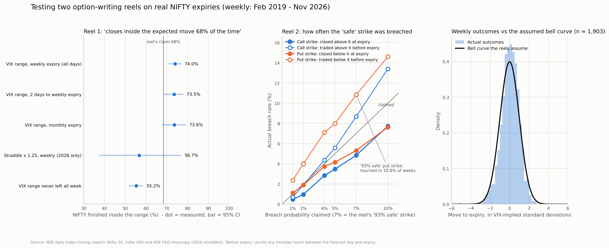

# Do the two "expected move" reels hold up? NIFTY weekly and monthly expiries, 2019–2026

| Claim | Verdict | Evidence (official NSE data) |
|---|---|---|
| **Reel 1:** NIFTY closes inside Spot ± Spot·VIX·√(days/365) **68%** of the time | **Holds for the close at expiry, even a bit conservatively.** Misleading if read as a trading range | Closed inside on **74.0%** of 1,903 days (405 weekly expiries; 95% CI 71–77%). 2 days before expiry, the reel's case: 73.5%. Monthly: 73.6%. Price stayed inside the whole time only **55.2%** |
| **Reel 1 "easy trick":** ATM straddle × 1.25 gives the same 68% range | **Not confirmed** (small sample) | 2026 only (official option prices, 15 expiries): **56.7%** (95% CI 38–77%). The straddle range was narrower than the VIX range |
| **Reel 2:** "Probability calculator" N(ln(K/Spot)/(VIX·√(DTE/365))); a 93% strike is a "safe zone" for option writing | **Probabilities roughly right at expiry; "safe zone" not supported** | "93% safe" put strike: closed below it **5.3%** of weeks (claimed 7%), but **traded below it before expiry in 10.8%** of weeks. "93% safe" call strike: 4.8% / 8.7% |

## What the reels say
* **Reel 1.** "Expiry is in 2 days: expected move = Nifty × VIX × √(2/365) ≈ 189 points. Easy trick: add the ATM
  call and put premiums (176.15) and multiply by 1.25 ≈ 220. The market will close inside this range 68% of the
  time over the coming 2 days."
* **Reel 2.** "Nifty probability calculator: z = LN(projection / CMP) / (VIX × √(days to expiry/365)), then NORMSDIST.
  With VIX 19 and 5 days to expiry, 93% probability Nifty stays below 24,500 and 96% it stays above 22,800. These
  are safe zones to write options."

Both reels use the same model: India VIX as the volatility of a log-normal (bell-curve) distribution. The 1.25 in
Reel 1 is the textbook conversion of an ATM straddle into one standard deviation (a straddle ≈ 0.8 σ, and
1 / 0.8 = 1.25). So one quantity tests every claim:
z = ln(close at expiry / spot) / (VIX/100 × √(DTE/365)). If the model were right, |z| ≤ 1 would happen 68% of the
time, z < 1.476 93% of the time, and so on.

## Data and method
* **NIFTY 50 and India VIX:** daily, 1 Jan 2019 to 16 Nov 2026 (1,946 sessions). Source: NSE's official
  `ind_close_all` files, read from independent public archives. 1,938 sessions are held by two or more archives,
  with identical Nifty 50 and VIX rows. NSE's own "Points Change" continuity passes on every pair; 8 breaks are
  each explained, by special weekend sessions the archives didn't store or one NSE file quirk. See
  [`data/history_verification.md`](data/history_verification.md).
* **NIFTY options:** NSE's official F&O bhavcopy, 3 Aug to 13 Nov 2026, the only period archived. The straddle uses
  the at-the-money strike for the nearest weekly expiry. The range is centred on the level the option prices imply
  (put-call parity): NSE's official index close is a last-30-minute average, while option closes are 15:30 prices,
  and the two differed by 44 points on average.
* **Expiries:** NIFTY weekly options from 14 Feb 2019. Thursday expiries until 28 Aug 2025, Tuesday from 2 Sep 2025;
  monthly on the last Thursday / last Tuesday. A holiday moves expiry to the previous trading day. All 15 weekly
  expiries in the 2026 option files match this calendar exactly. Tests also pin known holiday shifts (2021 Diwali,
  2023 Republic Day and Ram Navami, 2024 Independence Day). Short special sessions (Muhurat, weekend sessions) are
  excluded.
* **Test.** Every trading day is a "forecast day" for the next expiry: the spot is that day's close, VIX is that
  day's close, and days to expiry are calendar days. "At expiry" means the official close on expiry day, which is
  the options' settlement value. "Before expiry" means any intraday touch from the next session up to and including
  expiry day. Because days sharing an expiry are not independent, pooled confidence intervals resample whole expiries.

## Results



**Reel 1: share of days NIFTY finished inside the expected-move range** (claim: 68%)

| Range | Days / expiries | Closed inside at expiry | 95% CI | Stayed inside the whole time |
|---|---|---|---|---|
| VIX formula, weekly expiry (all days) | 1,903 / 405 | **74.0%** | 71–77 | 55.2% |
| VIX formula, 2 days to weekly expiry (reel's case) | 324 / 324 | **73.5%** | 68–78 | 52.2% |
| VIX formula, monthly expiry | 1,923 / 94 | **73.6%** | 68–79 | 54.6% |
| ATM straddle × 1.25, weekly (2026 only) | 67 / 15 | **56.7%** | 38–77 | 37.3% |

On average, realised moves were about 10% smaller than VIX implied: the realised-to-implied ratio was about 0.9,
except 2020 at 1.09. That is why the close landed inside more often than 68%. In 2026, the weekly ATM straddle
implied 11.9% volatility against an average VIX of 13.0%, so the straddle range was narrower and caught fewer
closes.

**Reel 2: how often the "safe" strike was breached** (weekly expiries; claimed = 100% − probability)

| Strike set at | Claimed breach | Call: closed above | Call: traded above before expiry | Put: closed below | Put: traded below before expiry |
|---|---|---|---|---|---|
| 90% | 10% | 7.7% | 13.4% | 7.6% | 14.6% |
| **93%** (reel's example) | **7%** | **4.8%** | **8.7%** | **5.3%** | **10.8%** |
| 95% | 5% | 3.5% | 5.6% | 4.2% | 8.0% |
| **96%** (reel's example) | **4%** | **2.8%** | **4.4%** | **3.7%** | **7.1%** |
| 98% | 2% | 0.9% | 1.9% | 1.9% | 4.0% |

Monthly expiries look similar: the 93% put strike was closed below 6.8% of the time and touched 11.5%. Breach rates
vary a lot by year. The 93% call strike was breached at expiry 1.4% of the time in 2019 and 7.7% in 2025; the 96%
put strike 0.8% in 2025 and 6.0% in 2020 (1.5× the claim). Full tables: [`output/RESULTS.md`](output/RESULTS.md).

**The reels' own examples**
* **Reel 1** (Fri 4 Sep 2026: NIFTY 23,897.70, VIX 10.68). The reel's 188.9 reproduces exactly with 2 days, but
  Friday's close to Tuesday's expiry is **4 calendar days**, which gives 267.2. NSE's end-of-day ATM straddle
  (23,950) was 174.05, so × 1.25 = 217.6. At the 8 Sep expiry NIFTY closed at **23,635.10, outside both of the
  reel's ranges**. It was just inside the correctly counted 4-day VIX range, by 4.6 points, and the day's low broke
  that range too.
* **Reel 2.** The formula does give 93.0% and 96.1% for the reel's inputs (implied spot about 23,709).

## What this means if you write options
1. **The maths in both reels is standard, and on NIFTY it was roughly right about where the index closes at expiry.**
   It was slightly conservative: VIX tends to overstate the move a little.
2. **"68%" is about the close, not the path.** In about 45% of weeks NIFTY traded outside the 1-standard-deviation
   range at some point before expiry. A short strangle at those strikes would often be tested or stopped out even
   when it ends up fine.
3. **"93% safe" still means about 1 bad week in 20 at expiry, and about 1 in 10 intraday** on the put side. Downside
   breaches are more frequent than upside ones, because markets fall faster than they rise. In stressed years
   (2020) breaches exceeded the claimed rate.
4. **A probability of expiring worthless is not a profit.** Option premiums already price these probabilities, so a
   93% strike pays a small premium, and the occasional breach can cost many weeks of it. Judging profitability needs
   a multi-year profit-and-loss backtest with real option prices, costs, margin and stop rules. This was not tested
   here, because only 2026 option prices are archived.
5. **Count days to expiry from the moment of your data.** Friday's close to Tuesday's expiry is 4 calendar days;
   using 2 understates the move by about 30%.
6. **Relation to the earlier Hybrid V1 study:** these tools describe where NIFTY closes at expiry, not its intraday
   High/Low. Their "stayed inside the whole time" rate (55%) is no better than Hybrid V1's range containment (58–62%).

## Limitations
* The straddle test covers only 15 expiries (2026), so its confidence interval is wide. Weekly results cover 405
  expiries across calm and stressed years.
* Forecast days use end-of-day prices. An intraday user (as in the reels) sees slightly different spot, VIX and premiums.
* Expiry dates before Aug 2026 follow NSE's rules applied to the trading calendar implied by the data. They match
  NSE's option files for 2026, and known holiday shifts in earlier years are covered by tests.
* Not investment advice. Nothing here shows that writing options at these levels is profitable.

## Reproduce
```bash
cd nifty_backtest/expected_move
python build_history.py     # 2019-2026 NIFTY/VIX history + 2026 NIFTY straddles, with all integrity checks
python analyze.py           # tables, chart, RESULTS.md, summary.json in output/
python -m pytest -q .       # calendar and formula tests
```
`build_history.py` clones the public archives (about 0.5 GB, mostly 2026 option files) into `../.cache/archives`, or
into `--cache-dir`. Executed in this session: Python 3.13.18, pandas 3.0.5, numpy 2.5.3, matplotlib 3.10.9. All
tests pass.
